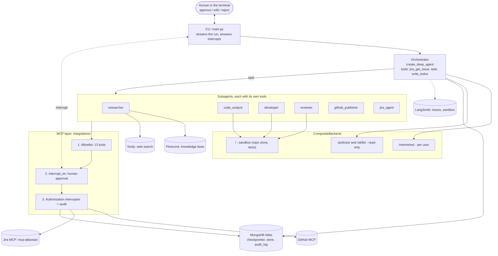

# Shipwright: from a Jira ticket to a reviewed pull request

Shipwright is a [Deep Agents](https://docs.langchain.com/oss/python/deepagents/overview) agent
(LangChain / LangGraph) that turns **one Jira ticket into one reviewed pull request**:

1. it reads the ticket and decides whether it can be done as is, is too big (an Epic is split
   into Tasks) or is too vague (it asks questions on the ticket and stops);
2. it plans the work and delegates it to specialist subagents;
3. it changes the code and runs the tests in a sandbox, then reviews its own diff;
4. it opens the pull request on GitHub and updates the Jira ticket.

**Every Jira and GitHub write stops for a human first** (approve, edit or reject), through Deep
Agents' `interrupt_on`. The human approves the exact arguments: approving `push_files` approves
the exact files pushed.

The project also exists to show **where each Deep Agents component goes in a real codebase**:
every file has one job and a docstring naming the concept it demonstrates.

## What the agent does

| Ticket | What happens |
|---|---|
| A clear bug or small feature | analyse the code → fix + tests in the sandbox → self-review → branch, push, PR → Jira comment + "In Review" |
| An Epic, or work too big for one PR | split into Jira Tasks under the Epic, one comment explaining the split, no code |
| Ambiguous (no acceptance criteria) | questions posted as a Jira comment, the run stops |
| Tests still red after N attempts | draft PR explaining what is left |

`demo/tickets.yaml` holds the 7 demo scenarios; they target
[`YanivBohbot/taskboard-api`](https://github.com/YanivBohbot/taskboard-api), a small FastAPI
service with known bugs.

## Status

Active branch: **`refactor/mcp-native`** (all Jira/GitHub access is native MCP). Unit tests: 137
passing, ruff and pyright clean.

Validated end to end, with real Jira, GitHub, OpenAI and MongoDB:
- **SHIP-1** (bug: empty assignee → HTTP 500): fixed, tested, reviewed,
  [PR #1](https://github.com/YanivBohbot/taskboard-api/pull/1) opened, Jira comment posted,
  ticket moved to *In Review*. Every write is traced in the MongoDB audit log.
- **SHIP-4** (ambiguous): stops at the clarification gate, questions posted, no code.
- **SHIP-7** (Epic): split into 5 Tasks (SHIP-8 to SHIP-12) plus a comment, no code.
- Smoke test of the 7 subagents against the real services: 7/7.

In progress:
- **SHIP-2**: real-world check of the `push_files` guard (the pushed files must equal the
  sandbox's changed files, paths and contents).
- **SHIP-5**: red tests → draft PR.
- LangSmith Deployment (`langgraph.json`, `docs/deployment.md`), evals in LangSmith.

### Branches

| Branch | Content |
|---|---|
| `main` | design spec and implementation plan |
| `feat/shipwright` | first implementation (16-task plan) |
| `refactor/simplify` | restructuring around `agent/` (one module per Deep Agents component) |
| `refactor/mcp-native` | **current**: MCP tools straight to the agent, per-subagent tools, authorization interceptors |

## Architecture



**The flow for a normal ticket.** The orchestrator reads the ticket and plans with `write_todos`.
It then calls, through `task`:
1. `code_analyst`: reads the code, recent commits and open PRs.
2. `developer`: edits the code and runs the tests in the sandbox.
3. `reviewer`: returns a structured verdict. On `changes_requested` the developer goes again.
4. `github_publisher`: creates the branch, pushes the files and opens the PR, one approval per write.
5. `jira_agent`: comments on the ticket and moves it, one approval per write.

### Where each Deep Agents component lives

| Component | `create_deep_agent` arg | File |
|---|---|---|
| Model (strong / light, fallback) | `model` | `core/config.py` |
| System prompts (Python constants) | `system_prompt` | `agent/prompts/<agent>.py` |
| Planning (`write_todos`) | `middleware` | `TodoListMiddleware` in `agent/middleware.py` |
| MCP tools (Jira, GitHub) | `tools`, subagent `tools` | `integrations/mcp.py`: `MultiServerMCPClient` + an allowlist by tool name |
| MCP authorization + audit | `tool_interceptors` of the MCP client | `integrations/authorization.py` |
| Custom tools | subagent `tools` | `agent/tools/workspace_tools.py` (diff, changed files), `knowledge_tools.py`, `web_tools.py` |
| Subagents (`task`), each with its own tools | `subagents` | `agent/subagents/` (table below); `general_purpose.py` overrides the built-in one |
| Structured subagent output | subagent `response_format` | `agent/subagents/reviewer.py` (`ReviewReport`) |
| Human-in-the-loop | `interrupt_on` (inherited by subagents) | `integrations/mcp.interrupt_on_for` (from MCP `readOnlyHint`); `agent/hitl.py` answers in the terminal |
| Backend (CompositeBackend) | `backend` | `agent/backend.py`: `/` sandbox, `/memories/` per user, `/policies/`, `/skills/` |
| Sandbox | default route of the backend | `sandbox/workspace.py` (local shell or LangSmith, clone, diff) |
| Permissions | `permissions` | `agent/backend.py` (`PERMISSIONS`, `SUBAGENT_PERMISSIONS`) |
| Skills (SKILL.md, loaded on demand) | `skills=["/skills/"]` | `agent/skills/*/SKILL.md` |
| Memory (always in the prompt) | `memory` | `/memories/preferences.md` (per user), `/policies/POLICIES.md` |
| Middleware | `middleware` | `agent/middleware.py`: planning, PII, call limit, retries, fallback, read-only filter |
| Context schema | `context_schema` | `agent/state.py` (`ShipwrightContext(user_id)`) |
| Checkpointer / store | `checkpointer`, `store` | `core/persistence.py` (MongoDB) |
| Deployment | `langgraph.json` → `graph.py:make_graph` | `src/shipwright/graph.py`, `docs/deployment.md` |

| Subagent | Its tools (* = human approval) |
|---|---|
| `researcher` | `knowledge_search`, `web_search`, `jira_get_issue`, `jira_search` |
| `code_analyst` | file tools (read) + `list_commits`, `list_pull_requests`, `search_code` |
| `developer` | file tools + `execute` (tests in the sandbox) |
| `reviewer` | file tools (read) + `show_workspace_diff` |
| `github_publisher` | `get_changed_files`, `list_branches`, `create_branch`*, `push_files`*, `create_pull_request`* |
| `jira_agent` | `jira_get_issue`, `jira_get_transitions`, `jira_add_comment`*, `jira_transition_issue`*, `jira_create_issue`* |

The orchestrator only has `jira_get_issue`, `task` and `write_todos`, plus the file tools. It can
read the code, but it can write only under `/memories/` and it never runs commands. A subagent's
`tools` key lists its extra tools: a subagent without that key would inherit every tool of the
orchestrator.

## Project layout

```
src/shipwright/
  main.py            CLI: `shipwright run <TICKET>`, approvals in the terminal
  graph.py           make_graph() for LangGraph / LangSmith Deployment
  audit.py           audit log of MCP writes (MongoDB, secrets redacted)
  core/              config.py (settings, .env), persistence.py (Mongo checkpointer + store)
  domain/            tickets.py (Jira ticket model)
  integrations/      mcp.py (MCP client, allowlist, interrupt_on), authorization.py (interceptors)
  sandbox/           workspace.py (local shell or LangSmith sandbox, clone, diff)
  knowledge/         ingest.py, search.py (Pinecone, or keyword search as fallback)
  agent/
    orchestrator.py  THE create_deep_agent(...) call: start reading here
    backend.py       CompositeBackend routes + permissions
    middleware.py    planning, PII, limits, retries, fallback, read-only filter
    hitl.py          terminal answers to interrupts
    state.py         context schema
    subagents/       one file per subagent
    prompts/         one system prompt per agent
    tools/           custom tools (workspace, knowledge, web)
    skills/          SKILL.md: coding-conventions, jira-workflow, pr-template, testing-guidelines
    policies/        POLICIES.md (always in the prompt, read-only)
scripts/             seed_jira.py, ingest_knowledge.py, smoke_subagents.py
knowledge/           specs, ADRs and architecture notes of the demo service (the knowledge base)
demo/tickets.yaml    the 7 demo tickets
evals/               dataset + evaluators (LangSmith)
tests/               unit tests (scripted model, fake MCP tools, real git for the local shell)
docs/                deployment, design spec, implementation plan
```

## Integrations

| Service | Used for | Variables (`.env.example`) | |
|---|---|---|---|
| OpenAI | strong model (orchestrator, developer) and light model (other subagents) | `OPENAI_API_KEY`, `MODEL_STRONG`, `MODEL_LIGHT` | required |
| GitHub, remote MCP server | read the repo, branch, push, PR | `GITHUB_PAT`, `GITHUB_MCP_URL`, `SHIPWRIGHT_REPO` | required |
| Jira, MCP server `mcp-atlassian` (stdio, installed as a Python dependency) | read tickets, comment, transition, create Tasks | `JIRA_URL`, `JIRA_USERNAME`, `JIRA_API_TOKEN`, `JIRA_PROJECT` | required |
| MongoDB Atlas | LangGraph checkpointer (threads, resume), store (per-user memory), audit log | `MONGODB_URI`, `MONGODB_DB` | required |
| LangSmith | traces; optional isolated sandbox; deployment | `LANGSMITH_API_KEY`, `LANGSMITH_TRACING`, `LANGSMITH_PROJECT` | optional |
| Pinecone | knowledge base (specs, ADRs) | `PINECONE_API_KEY`, `PINECONE_INDEX`, `PINECONE_NAMESPACE` | optional (keyword search otherwise) |
| LlamaCloud | parsing PDF specs at ingestion | `LLAMA_CLOUD_API_KEY` | optional |
| Tavily | web search for the researcher | `TAVILY_API_KEY` | optional |

The `.env` file is gitignored and never committed: only `.env.example` (with no values) is in the
repository.

## Run it locally

**Prerequisites:**
- Python 3.12 and [`uv`](https://docs.astral.sh/uv/);
- a GitHub account with a fine-grained PAT on the target repo;
- a Jira Cloud site with an API token;
- a MongoDB Atlas cluster (the free tier is enough).

1. **Install and configure**
   ```bash
   uv sync
   cp .env.example .env    # then fill in the values
   ```
   At startup, the settings check that the required secrets are not empty.
2. **Target repository.** It must be a **public** GitHub repo holding the demo service, because
   the sandbox clones it without credentials. Create your copy of `taskboard-api`, then set
   `SHIPWRIGHT_REPO=<you>/taskboard-api`. An `owner/name` or a GitHub URL both work.
3. **Jira project.** Create the project (`JIRA_PROJECT`, default `SHIP`) and add an *In Review*
   status to its workflow. Then create the demo tickets with
   `uv run python scripts/seed_jira.py`. The script is idempotent and writes the keys to
   `demo/seeded.json`, which is gitignored.
4. **Knowledge base (optional).** `uv run python scripts/ingest_knowledge.py` indexes
   `knowledge/` in Pinecone.
5. **Run**
   ```bash
   uv run shipwright run SHIP-1 --user alice
   uv run shipwright run SHIP-1 --thread <id>   # resume a paused run (threads live in MongoDB)
   ```
   At each approval, answer `approve`, `edit` (new JSON arguments) or `reject` (your reason goes
   back to the subagent; rejecting `push_files` with a reason works as review feedback for the
   developer).

**Sandbox** (`SANDBOX_PROVIDER`):
- `local` (the default) is a `LocalShellBackend` under `tmp/sandboxes/<thread>/`. It is **not
  isolated**: the developer's commands run on your machine, with a minimal environment and no
  secrets.
- `langsmith` is an isolated LangSmith sandbox. The feature must be enabled on your LangSmith
  organization.

**LangGraph Studio / Deployment:** `uv run langgraph dev` (graph `shipwright` in `langgraph.json`);
see `docs/deployment.md`.

## Security model

Three layers around the MCP tools (`integrations/mcp.py`):
1. **Allowlist.** Only 13 named MCP tools are loaded (7 GitHub, 6 Jira). Each subagent gets its
   own subset.
2. **Human approval.** Every tool the server does not mark `readOnlyHint: true` is in
   `interrupt_on`, and all subagents inherit it. This fails safe: a tool with no annotation needs
   approval.
3. **Authorization interceptor.** Every MCP call is checked after approval, so this includes
   arguments a human edited. The call must target the configured repo, write only `shipwright/*`
   branches, open PRs into `main` and touch only the configured Jira project. Otherwise it is
   refused (`NOT AUTHORIZED: ...`) and nothing is sent.

Also:
- **Only the developer can change code or run commands.** The orchestrator writes only under
  `/memories/`. The other subagents are read-only, and the built-in `general-purpose` subagent is
  replaced by a read-only one.
- **`push_files` guard.** The files pushed must be exactly the files changed in the sandbox, with
  the same paths and contents.
- `/policies/` and `/skills/` are write-denied for everyone.
- **No credentials in the sandbox.** The clone cannot push, because publishing goes through MCP
  only. The local shell gets a minimal environment without API keys or tokens.
- **Audit trail.** Every MCP write call of every agent, allowed or refused, is recorded in MongoDB
  (`audit_log`) with secrets redacted.

Limits:
- file deletions cannot be published, because `push_files` only writes files;
- the local shell is not an isolation boundary.

## Tests

```bash
uv run pytest            # unit tests: scripted model, fake MCP tools, real git for the local shell
uv run ruff check .
```

**Real smoke test of every subagent:** `uv run python scripts/smoke_subagents.py [name ...]`. It
uses the real model and the real MCP servers with read-only tasks; a write attempt pauses the run
and fails the case.

**Evals:** `evals/` holds the dataset and the evaluators; see `evals/README.md`.
